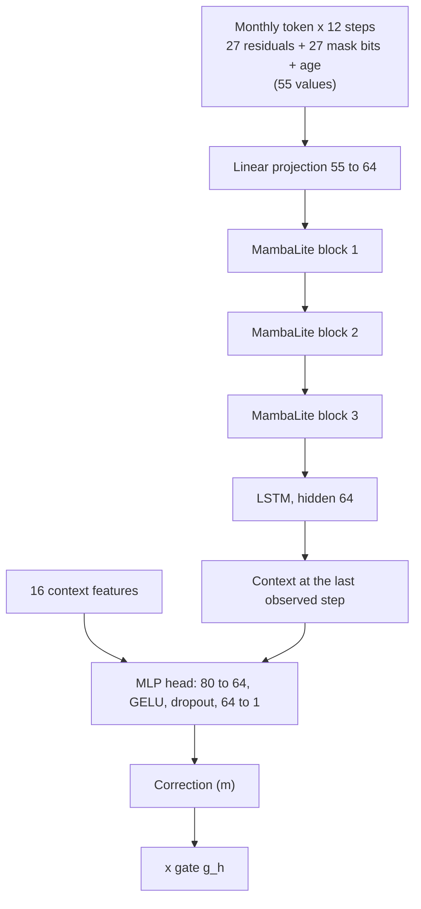

# MambaLSTM Forecasting Model

MambaLSTM is the core AI model of TERRA Coastal DT. It is a deep sequence model that reads the recent history of a stretch of coast and predicts how far the vegetation edge will move, beyond what a statistical forecast already explains. It is trained once on all sites and serves every live AOI.

!!! abstract "Model card"

    | | |
    | --- | --- |
    | **Model family** | `rolling_hybrid_mambalstm_v1` |
    | **Architecture** | Input projection, 3 Mamba-style blocks, 1-layer LSTM, MLP head |
    | **Parameters** | 192,641 |
    | **Task** | Predict the error of the statistical base forecast for one transect at one horizon |
    | **Input** | 12 monthly steps of base residuals over 27 neighbouring transects (390 m of coast), plus 16 context features |
    | **Output** | One correction in metres, scaled by a per-horizon gate |
    | **Horizons** | 1, 3, 6, 12 and 24 months |
    | **Training data** | 15 AOIs, Sentinel-2 history 2016 to 2026, rolling-origin splits with no look-ahead |
    | **Result** | Lowest held-out RMSE of all methods tested at every horizon ([Training & Evaluation](training-evaluation.md)) |

## The hybrid forecast

TERRA Coastal DT does not ask a neural network to forecast the coastline from scratch. Instead, it combines a statistical base forecast that is refitted at every request with a learned correction from MambaLSTM:

\[
\hat{y}_j(t_0 + h) \;=\;
\underbrace{\ell_j(t_0) \;+\; s_j(t_0 + h) \;+\; \phi^{\Delta}\, e_j(t_0)}_{\text{statistical base}}
\;+\; g_h \; \underbrace{f_\theta\!\left(\mathbf{R}_j, \mathbf{M}_j, \mathbf{a}, \mathbf{z}_{j,h}\right)}_{\text{MambaLSTM correction}}
\]

| Symbol | Meaning |
| --- | --- |
| \(\hat{y}_j(t_0+h)\) | Forecast vegetation-edge distance on transect \(j\), \(h\) months after the forecast origin \(t_0\) (the p50 line) |
| \(\ell_j(t_0)\) | Current level: the transect's fitted trend line evaluated at the origin. The trend sets where the edge is now but is not extrapolated |
| \(s_j(t_0+h)\) | Seasonal cycle at the target month (two harmonics per transect) |
| \(\phi^{\Delta} e_j(t_0)\) | Short-term memory: the last residual, decaying with the lag \(\Delta\) to the target month (AR(1), \(\phi \le 0.95\)) |
| \(f_\theta(\cdot)\) | MambaLSTM output: the predicted error of the base forecast |
| \(\mathbf{R}_j, \mathbf{M}_j\) | 12-month history of base residuals over the 27-transect patch centred on \(j\), and its observation mask |
| \(\mathbf{a}\) | Age of each history step relative to the origin |
| \(\mathbf{z}_{j,h}\) | 16 context features (calendar, horizon, position, trend, seasonality, data coverage, short-term memory) |
| \(g_h\) | Per-horizon gate in \([0, 1]\), fitted on held-out data |

The p10 and p90 bounds are added around the p50 line using calibrated error quantiles for that AOI and horizon (see [Uncertainty](#uncertainty)).

### Why a hybrid design

- **The easy part is solved in closed form.** Level, seasonality and short-term memory are well described by a small statistical model that is refitted on the AOI's whole record at every request. New observations change the forecast immediately, with no retraining.
- **The network learns only what is left.** MambaLSTM is trained on the base forecast's own errors. If it predicted zero, the hybrid would reproduce the base exactly, so the network cannot make things worse by forgetting what the base already knows.
- **The gate limits harm.** At each horizon the correction is scaled by the least-squares weight \(g_h = \mathrm{clip}\big(\langle y, p\rangle / \langle p, p\rangle,\, 0,\, 1\big)\) between the base's errors \(y\) and the network's predictions \(p\) on held-out data. Where the network has learned nothing transferable, \(g_h\) falls towards zero and the hybrid falls back to the base.
- **One model for every site.** The network is global across AOIs; each AOI's own behaviour enters through its data. That gives the network 15 sites' worth of training examples and lets it learn patterns that a single short record could not reveal.

### What the correction learns

Analysis of the base forecast's errors shows two slow signals hidden under month-to-month noise:

1. **Persistent level offsets.** When a stretch of coast has sat seaward (or landward) of its fitted level over the past year, about 40 to 60% of that offset persists 12 to 24 months later.
2. **Trend reversion.** Fast-moving transects tend to slow down: the realised change reverts by roughly half the fitted trend.

Neither is visible in a single month's residual, which is why simple autoregressive terms miss them. MambaLSTM reads a year of residuals across 390 m of coast and picks up both, together with alongshore context: neighbouring transects move together over about 90 to 105 m.

## Architecture



| Stage | Layer | Shape | Parameters |
| --- | --- | --- | --- |
| Input | One token per month: patch residuals, mask, age in years | 12 x 55 | |
| Projection | Linear | 55 to 64 | 3,584 |
| Temporal mixing | 3 MambaLite blocks (below) | 12 x 64 | 150,528 |
| Sequence memory | LSTM, 1 layer | 64 to 64 | 33,280 |
| Read-out | Hidden state at the last observed month | 64 | |
| Head | Concatenate 16 context features; Linear, GELU, Dropout 0.15, Linear | 80 to 64 to 1 | 5,249 |
| **Total** | | | **192,641** |

### MambaLite block

Each block is a lightweight, Mamba-inspired temporal mixer with a residual connection:

```text
h   = LayerNorm(x)
h   = causal depthwise Conv1d(h, kernel 4)      # each channel sees only the current and 3 previous months
a,b = split(Linear 64 -> 512 (h))               # two 256-wide halves
x   = x + Dropout( Linear 256 -> 64 ( tanh(a) * sigmoid(b) ) )
```

The causal convolution mixes information across neighbouring months without looking into the future. The gated MLP (\(\tanh \odot \sigma\)) lets the block decide, feature by feature, how much of that mixed signal to pass on. Three blocks give each step a receptive field of 10 months before the LSTM summarises the whole sequence. The block keeps the gating and causal convolution of Mamba but replaces its selective state-space scan with a short convolution, which suits the 12-step monthly sequences used here.

### Handling missing data

Cloud cover means many months have no observation for some or all transects.

- Each token carries the observation mask, so the network knows which values are real.
- Months with no observation anywhere in the patch are gated to zero before and after every block, so they contribute nothing.
- The read-out takes the LSTM state at the last observed month, not at a padded position.
- Each token carries its age, so irregular gaps between observations are visible to the network.
- Inputs are scaled and clipped, so an occasional extraction failure of 100 m or more cannot dominate a sequence.

### Context features

The 16 per-sample features give the head information that is not in the residual history:

| Group | Features |
| --- | --- |
| Calendar | Annual and semi-annual harmonics (sin, cos) of the origin month and of the target month (8) |
| Horizon | Forecast horizon in years |
| Position | Normalised position along the AOI; distance to the AOI end (km) |
| Transect behaviour | Fitted trend per year; seasonal amplitude |
| Data coverage | Fraction of the patch history that was observed |
| Short-term memory | The base's AR term; its coefficient \(\phi\) |

## Uncertainty

The p10 and p90 bounds use split-conformal calibration. The hybrid's own errors on a held-out calibration period give error quantiles (5, 10, 50, 90 and 95%) for each AOI and horizon. An AOI-specific quantile is used when at least 200 calibration errors are available; otherwise the pooled quantile across AOIs is used. Calibrating per AOI matters: a pooled band would be half as wide as it should be at the most dynamic site.

On test data the nominal 80% band (p10 to p90) covers 72 to 76% of outcomes, so it is slightly narrow. See [Training & Evaluation](training-evaluation.md#interval-coverage).

## Serving

At every forecast request the service:

1. loads the active model package (weights, gates, calibration) from the model registry;
2. adds the newest accepted observation to the AOI's monthly series;
3. refits the statistical base on the whole record up to that observation;
4. builds the MambaLSTM inputs with the same code used in training, so training and serving cannot drift apart;
5. computes base + gated correction for every transect, then the p10 and p90 bounds;
6. reconstructs forecast lines and erosion-risk areas (where the p10 line lies landward of the current edge) on the map.

Inference is light (one forward pass per transect and horizon on CPU). Horizons beyond 24 months are served with the correction and interval of the longest trained horizon for the same calendar month, and are flagged `horizon_extrapolated`, because the intervals were never calibrated that far out.

## Limitations

- The correction is a refinement: it improves the base by 2.9 to 6.5% RMSE. Most forecast skill comes from fixing the measurement frame and modelling level and seasonality correctly.
- Uncertainty bands are slightly narrow (72 to 76% coverage for a nominal 80%).
- The model sees only the coastline's own history. Storms, surges and wave climate are not yet inputs, so abrupt event-driven change is not anticipated.
- The model is trained on Scottish dune coasts. Other coastal types need validation before use.

See [Model Lifecycle](model-lifecycle.md) for how model versions are packaged, registered, promoted and retrained.
