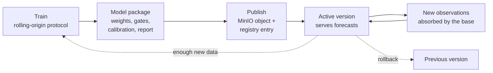

# Model Lifecycle

This page describes how a trained MambaLSTM model becomes the model that serves forecasts, how it stays current as new observations arrive, and how a new version replaces it.

## Model package

A model version is a self-contained package:

| File | Content |
| --- | --- |
| `best.pth` | Network weights, target scale, per-horizon gates and the input layout the network expects |
| `summary.json` | Model family (`rolling_hybrid_mambalstm_v1`), architecture, AOIs, horizons, gates, parameter count and test results |
| `calibration.json` | Conformal error quantiles per AOI and horizon, and pooled across AOIs |
| `validation.json` | Full rolling-origin test report for every method, per horizon and per AOI |

Because the gates and calibration travel with the weights, a package always serves exactly the forecast that was evaluated.

## Registry and serving

- Packages are stored as objects in MinIO; each version is registered in the MongoDB `model_versions` collection with its checksum, provenance and the dataset version it was trained on.
- Each AOI has one active model version. The registry decides which forecaster serves an AOI: the active version's model family selects the MambaLSTM hybrid, or the legacy statistical forecaster used by retired AOIs.
- The serving container downloads the active package on first use, verifies it, and keeps it only as a replaceable cache.
- Every forecast records the model version, dataset version and observation it was made from, so any forecast can be traced back to the exact model that produced it.

## Staying current without retraining

New observations do not require a new model. At every request the statistical base is refitted on the AOI's whole record, including the newest accepted observation, and the MambaLSTM inputs are rebuilt from that refit. A new month therefore changes the level, the short-term memory term and the network's input window immediately. The network weights capture patterns shared across sites and change only when the model is retrained.

## Retraining the correction

The shared MambaLSTM correction is retrained offline, with the same rolling-origin protocol, when enough new history has accumulated or when new AOIs are added:

1. Build the updated monthly datasets for the AOIs to include.
2. Run the training script. It trains the network, fits the gates, calibrates the intervals and evaluates every method on the most recent 24 months.
3. Compare the new test report with the active version's report.
4. Publish the package to the registry.

Retraining through the asynchronous job endpoint is reserved for per-AOI legacy forecasters; for hybrid AOIs the endpoint explains that the shared correction is retrained offline. Superseded packages are kept, so earlier results remain reproducible.

## Promotion and rollback

Model administration is restricted to administrators (bearer token, normally issued through the platform gateway):

- `POST /models/<model_version_id>/promote` promotes an evaluated candidate together with the dataset version it was trained on, in one atomic step.
- `POST /models/<model_version_id>/rollback` reactivates the previous version and its dataset.
- `GET /aois/<aoi_id>/model-status` reports the active version, any candidate, and retraining eligibility.

## Version history

| Version | AOIs | Change |
| --- | --- | --- |
| October 2026 (active) | 15 | Retrained after refining the St Andrews West Sands geometry (spit tip measured, reference line rerouted round the west hook) |
| October 2026 | 15 | Five further AOIs added on the Clyde, Aberdeenshire, Moray and Dornoch coasts |
| September 2026 | 10 | First rolling hybrid: rolling statistical base with gated MambaLSTM correction |
