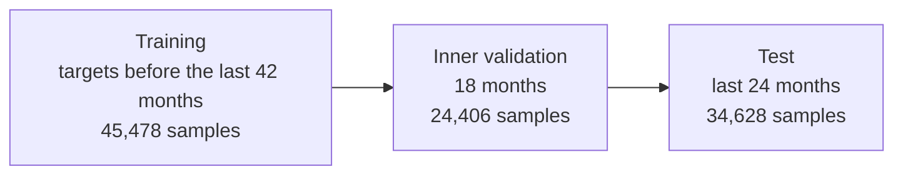

# Training & Evaluation

This page describes how the [MambaLSTM](mambalstm.md) correction is trained and how the hybrid forecaster is evaluated against other methods. Every number comes from the deployed model's own training run (October 2026, 15 AOIs).

## Data

| | |
| --- | --- |
| **Sites** | 15 AOIs (`aoi_01` to `aoi_15`) in 8 independent coastal groups |
| **Series** | Monthly vegetation-edge distance per transect: the median of the month's screened scenes, with alongshore outliers rejected |
| **Samples** | One sample per (transect, forecast origin, horizon) |
| **Horizons** | 1, 3, 6, 12 and 24 months |
| **Look-back** | 12 monthly steps |
| **Patch** | 27 transects centred on the target (390 m at 15 m spacing) |
| **Transect stride** | Every 15th transect (225 m), about twice the 90 to 105 m alongshore correlation length, so sampled transects are close to independent |

Every quantity attached to a sample, including the statistical base fit, the residuals and the context features, is computed only from data at or before the sample's forecast origin. The model never sees the future it is asked to predict.

## Rolling-origin splits

Splits are made by **target month**, counted back from the end of each AOI's record:

- **Training** samples fit the network weights.
- **Inner validation** samples choose the training epoch, fit the per-horizon gates and calibrate the uncertainty intervals.
- **Test** samples are used once, for the results below.

Forecasts are issued from every origin in the test period (about 290 origins per horizon), as they would have been in operation. Errors are aggregated per origin, then per AOI, then across AOIs, so every site counts equally however long its coastline.

An independent check moves the whole scheme 24 months earlier and discards everything after it. On the earlier 10-AOI configuration the ranking of methods held in that window as well.

## Optimisation

| Setting | Value |
| --- | --- |
| Target | The base forecast's error, scaled by its standard deviation (11.7 m) |
| Loss | Huber loss (\(\delta = 1\)) on the scaled target |
| Optimiser | AdamW, learning rate \(10^{-3}\), weight decay \(10^{-3}\) |
| Batch size | 512 |
| Gradient clipping | Norm 1.0 |
| Epochs | Up to 20, early stopping with patience 5 on inner-validation RMSE |
| Selected epoch | 5 (inner RMSE 11.13 m against 11.74 m for predicting zero, a 5.2% gain) |

After training, the per-horizon gates are fitted on the inner split:

| Horizon | 1 month | 3 months | 6 months | 12 months | 24 months |
| --- | --- | --- | --- | --- | --- |
| Gate \(g_h\) | 0.62 | 0.96 | 0.88 | 1.00 | 1.00 |

The correction is used at nearly full weight from 3 months on. At 1 month the base's short-term memory term already explains much of the error, so the correction is scaled down.

## Methods compared

All methods are trained and scored under the same rolling-origin protocol on the same samples.

| Method | Description |
| --- | --- |
| Persistence | No change: the last observation is the forecast |
| Trend only | Each transect's straight-line trend, extrapolated |
| Naive LSTM | A univariate LSTM (37,825 parameters): one transect's own 12-month history and the horizon, with no neighbours, calendar or statistical base |
| Base | The statistical base alone: level + seasonal cycle + AR(1) memory, refitted at every origin |
| **Hybrid (MambaLSTM)** | Base + gated MambaLSTM correction: the deployed model |

## Results

Test RMSE in metres (lower is better):

| Horizon | Persistence | Trend only | Naive LSTM | Base | **Hybrid (MambaLSTM)** |
| --- | --- | --- | --- | --- | --- |
| 1 month | 10.10 | 11.54 | 10.25 | 9.47 | **9.15** |
| 3 months | 14.06 | 12.17 | 11.44 | 11.00 | **10.54** |
| 6 months | 16.63 | 12.70 | 12.34 | 11.46 | **11.12** |
| 12 months | 12.89 | 12.89 | 11.23 | 11.61 | **10.86** |
| 24 months | 14.07 | 15.07 | 12.68 | 12.87 | **12.11** |

Reduction in RMSE achieved by the hybrid:

| Horizon | vs persistence | vs trend only | vs naive LSTM | vs base |
| --- | --- | --- | --- | --- |
| 1 month | 9.3% | 20.7% | 10.7% | 3.4% |
| 3 months | 25.1% | 13.4% | 7.9% | 4.2% |
| 6 months | 33.2% | 12.4% | 9.9% | 2.9% |
| 12 months | 15.7% | 15.8% | 3.3% | 6.5% |
| 24 months | 13.9% | 19.6% | 4.5% | 5.9% |

Number of AOIs (out of 15) where the hybrid has lower test RMSE:

| Horizon | vs base | vs naive LSTM |
| --- | --- | --- |
| 1 month | 13 | 9 |
| 3 months | 11 | 12 |
| 6 months | 9 | 14 |
| 12 months | 12 | 8 |
| 24 months | 12 | 9 |

### Reading the results

- **The hybrid is the most accurate method at every horizon.** The gain over the statistical base is largest at 12 and 24 months (6.5% and 5.9%), where the slow level offsets and trend reversion that MambaLSTM learns matter most.
- **Structure beats a bigger black box.** The naive LSTM has the same sequence length but sees only one transect and no statistical base. The hybrid beats it by 8 to 11% at 1 to 6 months and by 3 to 5% at 12 to 24 months.
- **Extrapolating trends hurts.** Trend-only is worse than persistence at 1 and 24 months. Trends fitted on the two halves of a record correlate at only -0.49 to +0.33, which is why the base sets the current level from the trend but does not extrapolate it.
- **Persistence is strong at 12 months** because a same-month observation one year earlier already carries the seasonal state. The hybrid still improves on it by 15.7%.

### Interval coverage

Share of test outcomes inside the p10 to p90 band (nominal 80%):

| Horizon | 1 month | 3 months | 6 months | 12 months | 24 months |
| --- | --- | --- | --- | --- | --- |
| Coverage | 76% | 75% | 74% | 74% | 72% |

The bands are slightly narrow because the inner split that calibrates them is also used to choose the epoch and the gates. A separate calibration period would correct this at the cost of training data.

## Lessons from model development

Several design decisions were settled by experiments under this protocol:

- **Earlier static baselines were optimistic.** A baseline fitted once on the whole record leaked future information into its own evaluation. The rolling, refit-at-every-origin base removed that look-ahead and is what all results above use.
- **Predicting the base's error works better than predicting the edge.** Residual models trained against a static baseline, including a 16,000-parameter convolutional model and an earlier MambaLSTM, early-stopped within 3 epochs at about the skill of predicting zero. Training against the rolling base's own error, with the gate, is what made the correction pay off.
- **Not extrapolating the trend** cut 24-month RMSE by 9 to 16% against a full-trend baseline in two independent test windows.

## Reproducing

The training script `scripts/train_hybrid_forecast.py` in the source repository runs the whole protocol and writes a model package (weights, gates, calibration, validation report). `--shift-months 24` runs the independent earlier window.
