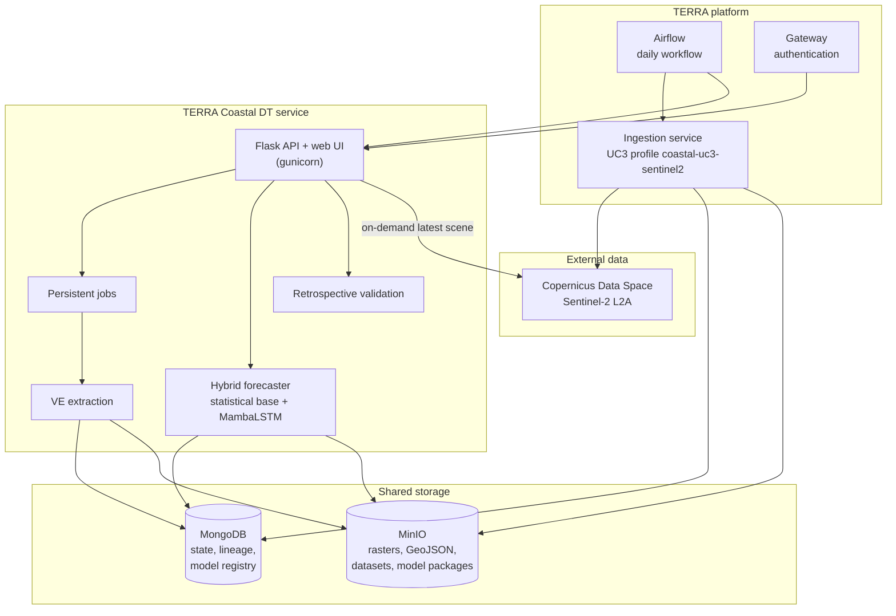

# Service Architecture

TERRA Coastal DT runs as one stateless service container next to shared MongoDB and MinIO stores. Durable state (observations, forecasts, datasets, model versions and artifacts) lives in the stores, so the container can be replaced or restarted at any time.

## Components

| Component | Responsibility | Documentation |
| --- | --- | --- |
| Satellite image processing | Catalogue search, AOI-level cloud screening, download, preflight checks | [Satellite Image Processing](components/satellite-image-processing.md) |
| Vegetation-edge extraction | Fixed geometry, classification, per-transect edge selection, temporal prior, quality control | [Vegetation Edge Extraction](components/vegetation-edge-extraction.md) |
| Time-series analysis and forecasting | Monthly series, MambaLSTM hybrid forecasts, erosion risk, historical coastlines | [Time-Series Forecasting](components/time-series-forecasting.md), [MambaLSTM](ai-model/mambalstm.md) |
| Digital twin orchestration | Assimilation, jobs, state, model registry, web interface and API | [DT Orchestration](components/digital-twin-orchestration.md) |
| Data ingestion profile | The UC3 acquisition profile run by the TERRA ingestion service | [Data Ingestion](data-ingestion.md) |

## Runtime

- **One process, many threads.** The service runs under gunicorn with one worker and several threads. Jobs run on an in-process executor, so a single process keeps job ownership simple.
- **Stateless container.** Downloaded datasets, model packages and the vegetation classifier are cached locally only after their checksums are verified, and can be deleted at any time.
- **Database-first reads.** AOIs, geometry, observations, datasets and active model versions are read from MongoDB; large objects are fetched from MinIO.
- **Provenance everywhere.** Observations carry a pipeline signature, and forecasts record the model version, dataset version and observation they were made from.

## Shared storage and namespacing

Every record is scoped by project and use case. In a shared platform database, UC3's collections carry the `uc3_` prefix, and its objects live under their own prefix in the shared bucket, so UC3 cannot read or overwrite other use cases' data. The service refuses to start against a shared database without the approved prefix, and never creates or alters collections there automatically.

## Security

- Credentials (CDSE, MongoDB, MinIO, admin token) come only from environment variables or mounted secret files; none are stored in code or images.
- Model administration (`/models/*`) requires an administrator bearer token. Other routes are intended to sit behind the platform gateway, which handles user authentication.
- Downloads are short-lived presigned MinIO links, so the service never streams large files itself.
- The container runs as a non-root user.

## Technology

| Layer | Technology |
| --- | --- |
| Service | Python 3.10, Flask, gunicorn |
| Geospatial | rasterio, pyproj, shapely, scikit-image |
| AI model | PyTorch (CPU inference), MambaLSTM |
| Storage | MongoDB (replica set), MinIO (S3-compatible) |
| Orchestration | Apache Airflow (TERRA platform) |
| Packaging | Docker image published to the GitHub Container Registry |
