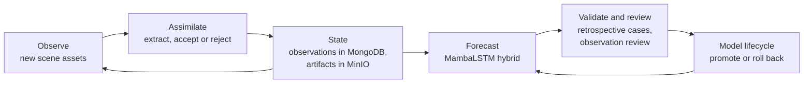

# Intelligent Coastal Digital Twin Orchestration

This component makes the processing capabilities behave as one digital twin: it keeps each AOI's coastal state current, coordinates observation, assimilation, forecasting and validation, and exposes the results to users and to the TERRA platform.

## The digital twin loop

1. **Observe.** New scenes arrive from the TERRA ingestion service as committed scene assets, or on demand from the web interface.
2. **Assimilate.** `POST /jobs/assimilate` processes the new assets for an AOI, oldest first. Each scene is checked against acquisitions already observed, extracted with the AOI's pinned parameters, and either committed as an observation or recorded as rejected with its reasons.
3. **Update state.** Accepted observations and their per-transect measurements are written to MongoDB; rasters, previews and GeoJSON are stored in MinIO. The container itself holds no durable state.
4. **Forecast.** The next forecast refits the statistical base on the updated record and applies the MambaLSTM correction (see [MambaLSTM Forecasting Model](../ai-model/mambalstm.md)).
5. **Validate and review.** Retrospective validation tests forecasts against later observations; operators can review individual observations.
6. **Model lifecycle.** New model versions are published, promoted or rolled back through the model registry (see [Model Lifecycle](../ai-model/model-lifecycle.md)).

## Jobs

Long-running work runs as persistent asynchronous jobs:

- each job has an identifier, ordered phase events and a final result, stored in MongoDB;
- clients poll `GET /jobs/<job_id>`;
- submissions accept an idempotency key, so a retried request does not create duplicate work;
- jobs left running by a stopped container are detected as stale and marked failed.

| Job | Purpose |
| --- | --- |
| `POST /jobs/assimilate` | Assimilate committed scene assets into an AOI's state |
| `POST /jobs/extract` | Extract the vegetation edge from given scenes of an AOI |
| `POST /jobs/predict` | Run a forecast |
| `POST /jobs/retrain` | Train candidate models for per-AOI legacy forecasters (the shared MambaLSTM is retrained offline) |

## Platform orchestration

In the TERRA platform, Apache Airflow is the control plane. A daily chain calls the TERRA ingestion service with the UC3 profile, skips quietly when no new scene exists, submits the committed scene assets to `POST /jobs/assimilate`, and reports accepted, rejected and duplicate observations. Forecasting remains a user or service action, and model promotion remains an explicit administrator decision. The service's in-process scheduler is disabled in platform deployments and kept only for local development.

## User interfaces

- **Forecast** (`/`): select an AOI, extract the latest observation, load history, forecast, and compare historical coastlines.
- **Validation** (`/validation`): run retrospective cases and compare the hybrid with other methods.
- **Baseline geometry** (`/baseline-workflow`): inspect and prepare reference lines and transects.

See [Forecast Workflow](../forecast-workflow.md) and [Retrospective Validation](../validation.md).

## Public interfaces

- `GET /`, `GET /validation`, `GET /baseline-workflow`
- `GET /dt/bootstrap`, `POST /dt/predict`
- `POST /jobs/assimilate`, `POST /jobs/extract`, `POST /jobs/predict`, `POST /jobs/retrain`, `GET /jobs/<job_id>`
- `GET /aois/<aoi_id>/observations`, `POST /observations/<observation_id>/review`
- `GET /health/live`, `GET /health/ready`, `GET /healthz`

## Current status

Implemented: persistent jobs with phase events and idempotency, database-first state in MongoDB and MinIO, scene-asset assimilation with duplicate detection, observation review, model registry with promotion and rollback, and the Airflow workflow for daily acquisition and assimilation.

## Planned work

- enable the daily Airflow schedule in the platform deployment after the acquisition pilot;
- report generation for coastal managers from forecasts and validation results.
