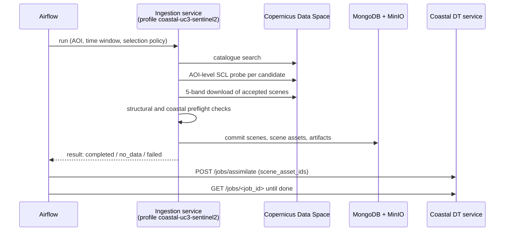

# Data Ingestion

In the TERRA platform, satellite data is acquired by a shared ingestion service that runs one profile per use case. TERRA Coastal DT provides its profile, **`coastal-uc3-sentinel2`**, as a standalone Python package (`terra-wp2-uc3-ingestion`). The package needs no part of the digital twin itself (no Flask, no PyTorch, no models), so the ingestion service can install it on its own.



## Division of responsibilities

| Ingestion profile | Coastal DT service |
| --- | --- |
| Catalogue search, AOI cloud screening, download | Fixed geometry and vegetation-edge extraction |
| Structural and coastal preflight checks | Scientific quality control and observation acceptance |
| Commits **scene assets** (rasters and their metadata) | Observations, datasets, models, forecasts, risk products |
| Holds the CDSE and storage credentials of the ingestion deployment | Owns the AOI registry and supplies AOI values per request |

The profile never writes observations, models, forecasts or geometry. It only delivers scene assets, which the digital twin then assimilates.

## Contract

All documents are validated against JSON schemas (JSON Schema 2020-12) shipped inside the package.

| Document | Purpose |
| --- | --- |
| Acquisition request (v2) | AOI, time window (latest or explicit), selection policy, retry identity |
| Scene package (v2) | One delivered asset: scene identity, acquisition time, AOI screening statistics, raster description, asset fingerprint and provenance |
| Ingestion result (v2) | Outcome and the committed scene asset identifiers |
| Assimilation request | The body sent to `POST /jobs/assimilate` |

Key rules:

- **Three explicit outcomes.** `completed` (new assets committed), `no_data` (nothing suitable: a normal outcome, skipped quietly), `failed` (a provider or storage error worth retrying).
- **Exact scene binding.** Each download is bound to the catalogue acquisition time within ±3 minutes, so an asset always means one satellite pass.
- **Retry identity.** A request's identity is derived from its content (project, AOI, window, policy), never from attempt time, so retries do not create duplicate assets.
- **Reuse before download.** An asset already committed for the same scene and AOI is reused.
- **Versioned meaning.** A change to what an asset means requires a new contract version; older requests are refused with an explanation rather than silently reinterpreted.

## Selection policies

| Policy | AOI cloud limit | Use |
| --- | --- | --- |
| `uc3_parity_pilot` | 10% unusable pixels; tile pre-filter 80%; up to 24 candidates probed; at most 3 scenes | Latest-observation updates |
| `uc3_monthly_backfill` | 20% unusable pixels | Filling historical months |

## Storage

The profile writes only three collections (`scenes`, `scene_assets`, `artifacts`, with the `uc3_` prefix in a shared database) and objects under the scene-input prefix of UC3's storage area. A deployment guard refuses to publish into the digital twin's live namespace unless that is explicitly allowed.

## Settings

All settings come from `UC3_INGEST_*` environment variables (CDSE client, MongoDB, MinIO, project, namespace). There are no built-in defaults for storage targets, so a misconfigured deployment fails instead of writing to the wrong place.

## Command-line tool

```bash
terra-wp2-ingest version
terra-wp2-ingest validate-examples
terra-wp2-ingest make-request --registry config/aois.json --aoi-id aoi_01 \
    --project-id terra --month 2026-08 -o request.json
terra-wp2-ingest run --request request.json --env-file ingest.env --publish
```

## Status

Package version 0.3.0 implements contract version 2 and passes its offline test suite. Registration in the platform ingestion service and the live acquisition pilot are in progress; until then, the digital twin acquires latest scenes itself on demand.
