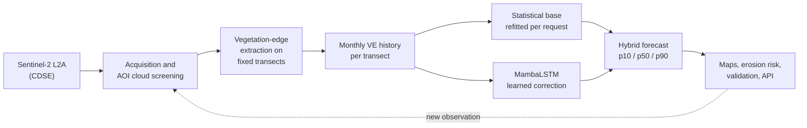

# TERRA Coastal DT

TERRA Coastal DT is the coastal digital twin of the [TERRA](https://terra-horizon.eu/) platform (use case 3). It watches the coastal **vegetation edge** (VE), the seaward limit of dune vegetation, on Scottish dune coasts. It turns every usable Sentinel-2 scene into a measurement on a fixed set of transects, keeps a monthly history for each site, and forecasts where the edge will be 1 to 24 months ahead, with an uncertainty range.

The forecasts come from a **hybrid AI forecaster**. A statistical model gives a baseline, and **MambaLSTM**, a deep sequence model trained on all sites together, learns to correct that baseline's errors.

!!! abstract "At a glance"

    | | |
    | --- | --- |
    | **Sites** | 15 live areas of interest (AOIs) on the east and west coasts of Scotland, in 8 independent coastal groups |
    | **Observations** | Sentinel-2 L2A from the Copernicus Data Space Ecosystem, monthly history since 2016, screened for cloud over the AOI itself |
    | **State variable** | Vegetation-edge distance along fixed cross-shore transects spaced 15 m apart (metres, seaward positive) |
    | **Core AI model** | [MambaLSTM](ai-model/mambalstm.md): 3 Mamba-style blocks and an LSTM, 192,641 parameters, one model for all sites |
    | **Forecast** | p10 / p50 / p90 vegetation-edge lines at 1, 3, 6, 12 and 24 months, plus erosion-risk areas |
    | **Accuracy** | 9.2 m RMSE at 1 month and 10.9 m at 12 months on held-out data; best of all methods tested at every horizon |
    | **State storage** | MongoDB and MinIO: observations, forecasts, datasets and model versions with full provenance |

## How the digital twin works

1. **Observe.** New Sentinel-2 scenes are found, screened for cloud over the AOI, and downloaded ([Satellite Image Processing](components/satellite-image-processing.md), [Data Ingestion](data-ingestion.md)).
2. **Measure.** The vegetation edge is extracted on the AOI's fixed reference line and transects, so every date is measured in the same frame ([Vegetation Edge Extraction](components/vegetation-edge-extraction.md)).
3. **Remember.** Accepted observations become monthly per-transect series, stored with their provenance ([Data & State Model](data-state.md)).
4. **Forecast.** The statistical base is refitted on the whole record at every request, and MambaLSTM adds its learned correction ([MambaLSTM Forecasting Model](ai-model/mambalstm.md)).
5. **Check.** Retrospective validation reruns the forecast from earlier dates and compares it with what was later observed ([Retrospective Validation](validation.md)).

## Why MambaLSTM

The baseline captures the slow trend, the seasonal cycle and short-term memory of each transect. What it cannot capture is the information in a transect's **neighbourhood and recent history**: for example, a stretch of coast that has sat seaward of its long-term level for a year tends to stay there, and a fast-moving stretch tends to slow down. MambaLSTM reads a 12-month window of the baseline's errors across a 390 m stretch of coast (27 neighbouring transects) and learns these patterns across all 15 sites at once.

On data the model never saw during training, the hybrid reduces RMSE against the baseline by 2.9 to 6.5%, against a plain LSTM by 3.3 to 10.7%, and against "no change" by 9.3 to 33.2%. A per-horizon gate ensures the correction is only applied as far as it has proven useful. See [Training & Evaluation](ai-model/training-evaluation.md).

## Documentation map

| Section | What it covers |
| --- | --- |
| [AI Model](ai-model/mambalstm.md) | MambaLSTM architecture, inputs, training protocol, evaluation results and model lifecycle |
| [Components](components/satellite-image-processing.md) | The four product-chain components: image processing, VE extraction, forecasting, DT orchestration |
| [System](architecture.md) | Architecture, data and state model, the TERRA ingestion profile, API |
| [Workflows](forecast-workflow.md) | The forecast and validation workflows in the web interface, and the technical approach |
| [Setup & Operations](deployment.md) | Deployment, configuration and maintenance |
| [Material](qa.md) | Quality assurance and frequently asked questions |
